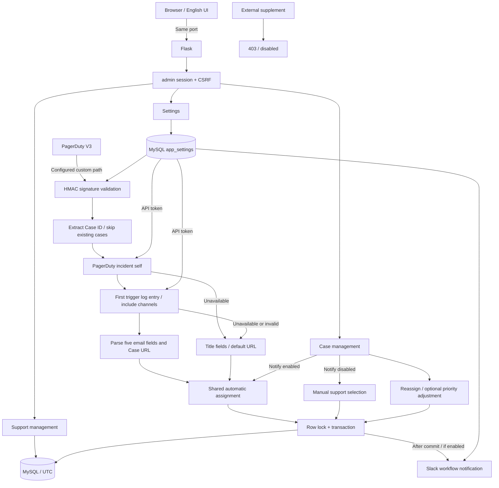

## v0.7 架构

- 页面由 Flask 渲染，静态 CSS/JS 由同一个服务提供；不存在独立前端容器。
- 自动分配、手动分配和重新分配共用 MySQL 事务与队列锁，数据库层按 Support ID 更新。
- Settings 是业务配置唯一来源，数据库连接与管理员密码仍通过 env 提供。
- API 时间使用 UTC ISO 8601，浏览器负责本地化显示和输入转换；历史 DATETIME 不自动改写。
- 通知失败不会回滚已提交的 Case，返回 `207 partial_success`。
- 新 Case 在外部 API 查询前去重，在事务内写入前再次去重；外部查询不占用队列锁。
- Case URL 持久化到 `cases.url`，旧数据使用默认 URL；手动新增时无论是否通知都支持高级选项中的自定义 URL，留空使用默认值。Subject/Product 仅用于通知，不入库；重新分配不改动 URL。
- Slack JSON 为 `{message, url, uid}`，自动分配和手动新增消息不包含 Support 姓名，Reassign 的 Note 包含原、新 Support 姓名；Support ID 只通过 uid 传递。
- API Token 在 Settings 管理，Base64 编码保存在 MySQL，仅向受限的 PagerDuty API URL 发送，不跟随重定向。
