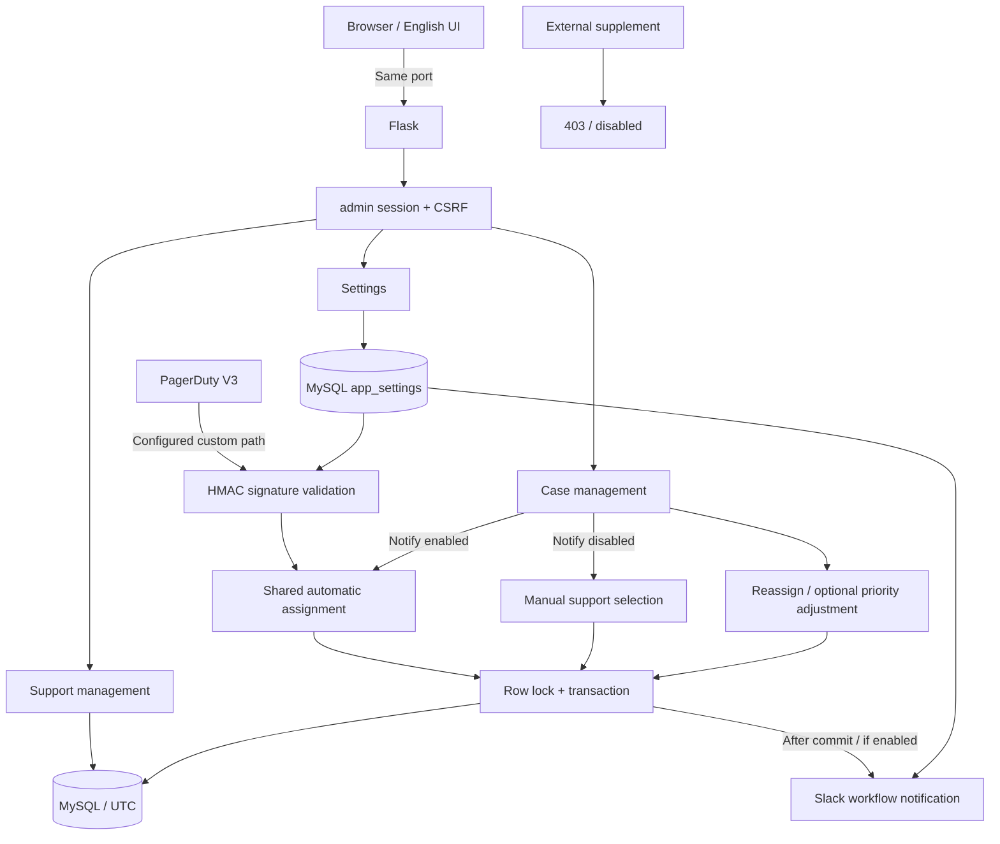

## v0.6 架构

- 页面由 Flask 渲染，静态 CSS/JS 由同一个服务提供；不存在独立前端容器。
- 自动分配、手动分配和重新分配共用 MySQL 事务与队列锁，数据库层按 Support ID 更新。
- Settings 是业务配置唯一来源，数据库连接与管理员密码仍通过 env 提供。
- API 时间使用 UTC ISO 8601，浏览器负责本地化显示和输入转换；历史 DATETIME 不自动改写。
- 通知失败不会回滚已提交的 Case，返回 `207 partial_success`。
